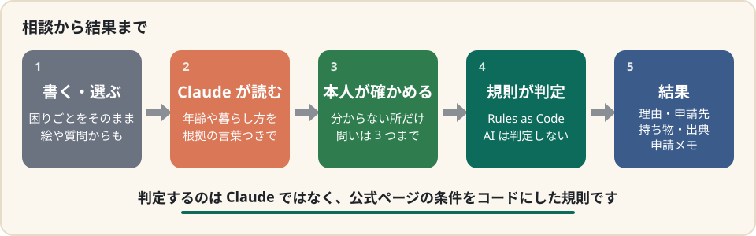
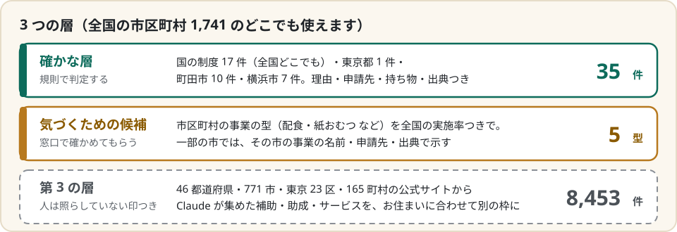
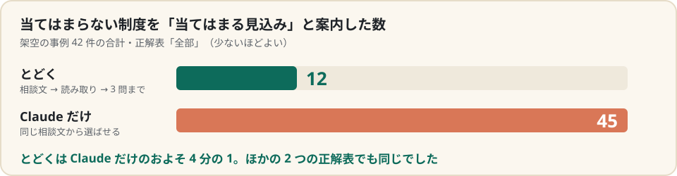

# とどく ― 尋ねなかった制度まで

高齢の方や介護する家族が困りごとを書くと、**尋ねていない公的制度まで**、判定の理由・申請先・持ち物・出典つきで示す相談窓口です。**全国の市区町村（1,741）のどこでも使えます。** 国の制度は規則で判定し、市区町村の事業 5 種類は全国の実施率つきの候補として示します。

**試す**：https://todoku.fly.dev/ で、ご自分の相談を合言葉なしで送れます。「見本で試す」（例：「要介護4の祖母」）は、いつでも最後まで動きます。Claude に使う費用が 1 日の上限に届いた日は、見本だけになります。

| | |
|---|---|
| 誰の、どんな課題 | 働きながら親を介護する家族と、高齢の本人。知らない制度は、尋ねることもできない |
| できること | 困りごとを書く（話して入力も）・絵から選ぶ・質問に答えるだけで、尋ねていない公的制度まで、判定の理由・申請先・持ち物・出典つきで示す |
| デモ動画（3 分） | https://youtu.be/kOk5gGP9N4M |
| 使った技術 | Python 3.12・FastAPI・Claude API（Claude Opus 5.5）・Claude Code・素の HTML／CSS／JavaScript・Fly.io |
| ライセンス | MIT（外部の出典の条件は、詳細版の[出典と利用条件](DETAILS.md#出典と利用条件)） |

> この README は要約版です。全部の説明は **[詳細版（DETAILS.md）](DETAILS.md)** にあります。

### なぜ作ったか

知らない制度は、尋ねることもできません。たとえば「母が退院してから家で転びやすくなった」と書くと、要介護認定の申請に加えて、認定のあとで使える税の障害者控除や住宅改修・福祉用具まで、手続きの順番つきで出てきます。介護・看護のために仕事を辞めた人は、1 年で 10.6 万人います（[令和4年就業構造基本調査](https://www.stat.go.jp/data/shugyou/2022/pdf/kgaiyou.pdf)）。

### どこまで扱うか

### 確かめた結果

正解は、とどくの規則と、規則を持たない Claude の 2 つの読みを突き合わせて作り、食い違ったマスは作者が裁きました。問いの数ごとの数字・正解の作り方・限界は、詳細版の[評価](DETAILS.md#評価)にあります。

### Claude をどう使ったか

- **作品の中**：Claude API（Opus 5.5）が、相談文から事実を根拠の言葉つきで読み、最後のまとめを書きます。どの制度に当てはまるかの判定はしません。
- **作る側**：Claude Code が、公式ページから規則とテストを書きました（Skill で同じ手順に）。公式ページを読む調査役のサブエージェント、事例を書く係に規則を見せないフック、行政手続データの MCP、本番を点検する Managed Agents を役ごとに使い分け、作者が離れている間も非対話の `claude -p` が改善を続けました。詳しくは詳細版の [Claude の使い方](DETAILS.md#claude-の使い方)。

> Built with Claude: Japan 2026（2026-11-02〜11-08）の期間中に新しく作りました（詳細版の[期間中に作ったもの](DETAILS.md#期間中に作ったもの)）。

### 詳しく（詳細版 DETAILS.md）

- 使い方と中身：[主な機能](DETAILS.md#主な機能) ・ [判定は規則、言葉は Claude](DETAILS.md#判定は規則言葉は-claude) ・ [2 つの層](DETAILS.md#2-つの層確かな判定と気づくための候補) ・ [第 3 の層](DETAILS.md#第-3-の層都道府県市区町村の公式サイトから自動で集めた制度) ・ [包括の職員が使うとき](DETAILS.md#包括の職員が相談を受けながら使うとき) ・ [扱う制度](DETAILS.md#扱う制度確認日は-120-が-2026-11-022140-が-2026-11-031469-は-2026-11-03-に確かめた出典も持つ)
- 確かめ方：[評価](DETAILS.md#評価) ・ [出典と利用条件](DETAILS.md#出典と利用条件)
- 動かす人へ：[使った技術と動く環境](DETAILS.md#使った技術と動く環境) ・ [動かし方](DETAILS.md#動かし方)
- これから：[ハッカソンの後](DETAILS.md#ハッカソンの後) ・ [今後](DETAILS.md#今後) ・ [ライセンス](DETAILS.md#ライセンス)
