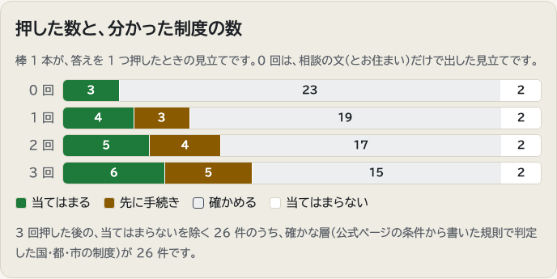

# とどく ― 尋ねなかった制度まで

高齢の方や介護する家族が困りごとを書くと、**尋ねていない公的制度まで**、判定の理由・申請先・持ち物・出典つきで示す相談窓口です。**全国の市区町村（1,741）のどこでも使えます。** 国の制度はどこでも規則で判定し、市区町村の事業 5 種類は全国の実施率つきの候補として示し、東京都・横浜市・町田市は都・市の制度まで詳しく判定します。さらに、全国 46 都道府県・771 市・東京 23 区の公式サイトから Claude が集めた個別の補助・助成・サービス 7,397 件を、お住まいに合わせて別の枠で示します（人は照らしていない印つき）。書くのが難しければ、選ぶだけで相談の文の下書きを作れます。

**試す**：https://todoku.fly.dev/ で、ご自分の相談を合言葉なしで送れます。「見本で試す」（例：「要介護4の祖母」）は、いつでも最後まで動きます（前の URL https://todoku-machida.fly.dev/ を開くと、この新しい URL に転送されます）。Claude に使う費用が 1 日の上限に届いた日は、見本だけになります。

扱う範囲は次の 3 段と、人が照らしていない自動で集めた層です。

- **国の制度 17 件は、全国どこでも規則で判定します。**
- **都道府県の制度は、東京都の 1 件（シルバーパス）を判定します。** 神奈川県は、個人で申し込める県の制度が見つかりませんでした（2026-11-03 に県の「介護・高齢者」の案内を全部見た。補聴器の補助などは市町が申し込み先で、県は費用を出すだけ）。ただし 2026-11-07 に Claude が県の公式サイトから自動で集めた中に、高齢者の案内の外にある県の駐車場の利用証（要介護1以上の人も対象）が 1 件あり、結果の画面の「市区町村の公式サイトから自動で集めた制度」に出します。
- **市区町村の独自の制度は、作者が暮らす町田市の 10 件と、横浜市の 7 件を詳しく判定します。** ほかの市区町村では、全国の調査（2017 年 4 月時点）で多くの市町村がしていた事業の「型」5 件を、窓口で確かめる候補として示します。札幌市・大阪市・福岡市など一部の市では、型のうち市の公式ページで見つかった事業を、その市の事業の名前・申請先・出典で示します（`rules/local/`。Claude が公式ページから書き、別の読み手が原文と照らし直したものだけを置き、画面にもその印と日付を出します）。住所が分かったら、住所だけで外れる市・都の制度と、ほかの地域の制度の名前や数は出しません。
- **都道府県と市区町村の公式サイトから自動で集めた個別の補助・助成・サービス**（2026-11-07）：46 都道府県と、全国の市と東京 23 区（頁を取得できなかった 19 市を除く 771 市・23 区）の 7,397 件です。Claude が公式サイトだけを読み、機械と自動の裁定で確かめましたが、人は照らしていません。結果の画面の別の枠に、その印を付けて出します（下の「第 3 の層」）。町と村は、ほとんど調べていません（試しの 5 か所だけ）。

知らない制度は、尋ねることもできません。たとえば「母が退院してから家で転びやすくなった」という相談には、要介護認定の申請に加えて、認定を受けたあとで使える税の障害者控除（町田市の認定書が先に要る）や住宅改修・福祉用具まで、前提の手続きの順番つきで出てきます。使う予定があるかは聞きません。

働く家族の側の制度は、あまり使われていません。介護をしながら雇われて働く人のうち、介護休業を使ったのは 3.2% でした（総務省「平成24年就業構造基本調査」、[厚生労働省の資料](https://www.mhlw.go.jp/file/05-Shingikai-12602000-Seisakutoukatsukan-Sanjikanshitsu_Roudouseisakutantou/0000103635.pdf)）。介護・看護のために仕事を辞めた人は、1 年で 10.6 万人います（[令和4年就業構造基本調査](https://www.stat.go.jp/data/shugyou/2022/pdf/kgaiyou.pdf)）。

> Built with Claude: Japan 2026（2026-11-02〜11-08）の期間中に新しく作りました。下の「期間中に作ったもの」を参照してください。

## 判定は規則、言葉は Claude

| 役割 | 担当 |
|---|---|
| 相談文から事実（年齢、認定、暮らし方など）を取り出す | Claude（構造化出力。事実ごとに確信と、相談文の中の根拠の箇所を返す） |
| 根拠が相談文に本当にあるかを確かめる | プログラム（見つからなければ確信を下げ、確かめる問いに回す。根拠は相談文に見つかったものだけを 200 字までで画面に返す） |
| 40 制度のそれぞれに当てはまるかを決める | 規則のプログラム（`rules/programs/*.yaml`） |
| 次に何を聞くかを決める | 規則のプログラム（答え次第で判定が変わる制度の数 × 重み） |
| 申請先・持ち物・金額・出典 | 規則ファイル（公式ページの条件を自分の言葉で書き、出典と確認日を付けたもの。原文を引用した所と写した値は「出典と利用条件」に書いた） |
| 最後のまとめ（「まず〜をすると、〜も使えるように」） | Claude（画面に出ている制度だけを指す。数字・URL・「必ず」などの言い切り・渡していない制度の名前を含む行は、プログラムが捨てる） |

**Claude に「分からない」と言わせる**：要介護の区分は、文に書いてあっても必ず書類で確かめてもらいます（家族の思い違いで判定が大きく変わるため。評価の事例で見つけて直しました）。

判定を Claude に任せないのは、同じ相談に同じ答えを返し、理由を条件ごとに示し、テストで確かめられるようにするためです。Claude が公式ページの文章から答える作り（RAG）にもしていません。

**AI の答えをそのまま信じなくてよいように**：当てはまるかを決めるのは規則のプログラムで、制度のカードには出典の公式ページと確認日を付け、Claude が読み取った事実は根拠の言葉が相談文に本当にあるかをプログラムが確かめて、見つからなければ問いに回します。

## 2 つの層：確かな判定と、気づくための候補

結果の制度は、確かさの違う 2 つの層に分けて数えます。

- **確かな層（国・都・市の制度 35 件）**：公式ページの条件を自分の言葉で書いた規則で判定します。規則はテストで確かめ、下の「評価」の架空事例で精度を測ります。
- **プラスアルファの層（市区町村の事業の型 5 件）**：配食・見守りや紙おむつの支給のように、全国の多くの市町村がしている事業の「型」です。年齢や認定などの一般的な条件では判定しますが、お住まいの市区町村がその事業をしているか、市の細かい条件に合うかは判定していません（上の一部の市でその市の事業の名前と申請先を添えるときも、判定の条件は型のままです）。気づいてもらうための候補として、窓口で確かめるよう添えて出します。

## 第 3 の層：都道府県・市区町村の公式サイトから自動で集めた制度

確かな層と型の層のほかに、全国の都道府県と市区町村の**個別の補助・助成・サービス**（紙おむつ、配食、緊急通報、補聴器の助成、タクシー券、駐車場の利用証、シニアの優待など 16 の型）を、Claude が各自治体の公式サイトから集めて示します。人は照らしていないので、確かな層とは別の畳んだ枠「市区町村の公式サイトから自動で集めた制度」に、その印と日付を付けて出します。

- **どこまで済んだか**（2026-11-07 20:40 時点）：都道府県 46／47、市 771／790、東京 23 区は全部（町田市・横浜市は市の制度を一つずつ判定しているので除く）。制度は合わせて 7,397 件です。
  - 調べていない所：町 740 と村 181（試しの 5 か所を除く）。人口の多い市と区を先にし、町村は今回は調べていません。
  - 読む係が頁を取得できなかったサイト（20 か所。愛知県のように自動の取得を止めている所、メンテナンスや障害で開けなかった所を含む）は、迂回せず、記録を作っていません。「見つからなかった」とは出しません。このうち 2 か所（鹿角市・砺波市）は、あとで別の取得で頁が開けたので、読み直せば入れられる見込みです。
- **集め方**：
  1. **読む**：Claude Sonnet 5.5（API）に、その自治体の公式サイトだけを検索・取得させました。公式サイトのホストは Wikidata（全国地方公共団体コードと公式ウェブサイト、CC0）から取り、検索と取得の道具の `allowed_domains` に入れたので、ほかのサイトは道具の側で読めません。頁の文は写さず、型・条件の値（年齢・要介護度・暮らし方・住民税・在宅など）・申請先・金額を決まった形で書かせました。
  2. **機械で確かめる**：出典の URL が公式サイトの中にあること、頁を取り直すと制度の名前がそのまま載っていることを、プログラムが確かめます。外れた制度は入れません。
  3. **自動の裁定**：別の呼び出しの Claude が、作者がこれまで正解表と市の事業の調べで使ってきた基準（申し込み先・頁に無い条件を足さない・選択肢の条件を値にしない・受付を終えたものは落とす など）で、頁の抜き出しと見比べて、残す・直す・落とすを決めます。残した 6,238 件・直した 1,152 件・落とした 84 件でした（落とした理由の多くは、申し込み先がバス会社や警察、受付の終了、頁で確かめられないもの）。
- **判定**：条件の値は今の事実に置き換えて、規則として判定します（Claude に判定させない）。人が照らしていない記録なので、値にした条件がそろっても「当てはまる見込み」とは言わず、「確かめると使えるかもしれない」か、値にした条件で外れた「当てはまらない」だけを出し、どの制度にも「ほかの条件は申請先で確かめる」を添えます。
- **評価を動かさない**：この層は、問いの選び方にも、採点する制度（1〜32 番）にも入りません。規則だけの評価は、この層を入れる前と同じ 88.4%・11・28 です。
- **抜き取り検査**：API で読んだ記録から無作為に 30 件を選び、別の読み手（Claude）が 30 件全部の頁と照らしました。誤りなし 26 件、頁にある年齢・世帯・金額の書き落としだけ 3 件、暮らし方の値が頁より狭いおそれのある境界の 1 件でした。書き落としは「確かめる」に寄る向き、境界の 1 件は「当てはまらない」に寄る向きです。人による検査はしていません。
- **裁き方のぶれ**：裁定役は呼び出しごとに別の Claude なので、同じ型でも裁き方がそろわないことがあります（例：市の補助で申し込みがバス会社の窓口のものを、残した市と落とした市があります）。
- **費用と時間**：11/7 の 1 日で作りました。API で約 404 ドル・約 2 時間（都道府県・政令市・中核市と多くの市）。API の組織の月の上限に届いたあとの残りの市 100 か所と、その前の都道府県・政令市の一部は、Claude Code のサブエージェント（サブスク）で同じ手順・同じ基準で読み、裁きました。

## 手間と、分かること

入力にあまり手間をかけなくても「こんな制度が申請できるかも」と気づけることを、目的にしました。相談の文とお住まいだけでも、確かめると使えるかもしれない制度までを並べます。答えを 1 つ押すたびに「確かめる」が「当てはまる」「先に手続き」に分かれ、3 問で止まります。

結果の画面には、押した数ごとの見立てを積み上げ棒で出します。下の図は見本「退院した母」で、問いにそれぞれ先頭の選択肢で答えた場合です。0 回では当てはまる 1 件と確かめる 25 件、3 回押した後は当てはまる 4 件・先に手続き 7 件・確かめる 15 件でした。1 回目の答え（認定を受けていない）では数は変わらず、2 回目で要介護認定の申請が当てはまり、その先の手続きが並びます。



## 包括の職員が相談を受けながら使うとき

地域包括支援センターの職員が、窓口や訪問で相談を受けながら使うこともできます。職員向けの別の画面は作っておらず、今の画面を次のように使います。

- **相談の場で画面を一緒に見る**：ご本人や家族と同じ画面を見ながら問いに答えます。相談の前に、お住まいの市区町村の頁（`/city/<団体コード>`）で、その市で使える制度の一覧を見ておくこともできます。
- **印刷を職員の控えにする**：結果の画面をブラウザで印刷すると、札が開いて申請先・持ち物・出典まで紙に出ます。1 部を職員の控えに、1 部をご本人に渡せます。札ごとの申請メモは 1 枚ずつ刷れます。とどくは相談の文章を保存しないので、控えは紙か「この結果を残す」のリンクで持ちます（リンクには認定の区分などの答えが入ります）。紙の控えもリンクもご本人の情報なので、保管や受け渡しはセンターの個人情報の取り扱いの決まりに従ってください。
- **判定は規則、確かめは職員**：判定は規則のプログラムが出した目安で、職員の判断の代わりにはしません。窓口の扱いに合うか、ご本人の事情で変わらないかは、職員が確かめます。

包括の職員に使ってもらって確かめたことは、まだありません（下の「ハッカソンの後」）。

作者の家族 1 人に、期間中に使ってもらいました（2026-11-07）。自分の相談を書いても合言葉で止まり、案内どおり見本を押すと町田市の見本の結果が出て、「町田市に設定された」としか見えない所が見つかりました。そこで、合言葉なしで自分の相談を送れる形にし（費用は 1 日の上限で守る）、見本を開いたときは見本の相談の文を見出しに出すようにしました。1 人の試用なので、数としての評価には入れていません。

## 制度の状態

| 状態 | 意味 |
|---|---|
| 当てはまる見込み | 聞ける条件をすべて満たす。残りは申請で確かめられる（医師の意見、市の審査、所得の書類など） |
| 申請済み・結果待ち | 要介護・要支援の認定を申請中で、結果を待っている。認定が前提の制度は「先に手続きをすると使える」のまま |
| 先に手続きをすると使える | 前提の手続き（要介護認定、町田市の認定書・確認書、医師の証明書、身体障害者手帳）を済ませれば対象になりうる |
| 確かめると使えるかもしれない | 判定を決める事実が分からない。確かめ方を添えて出す |
| 当てはまらない | 条件を満たさない。理由つきでたたんで出す |
| 済んでいる | もう認定を受けているなど、済んでいる手続き。「当てはまらない」と一緒にたたんで出す |

「わからない」も正式な答えです。

## 先行例から学んだこと（2026-11-04 に調べた）

国内外の行政・研究・民間の取り組みを調べました。海外には、当てはまりそうな制度をまとめて示す道具が多くあります（フランスの [Mes Aides](https://caf.fr/allocataires/caf-de-seine-et-marne/actualites-departementales/simulateur-mes-aides-evaluez-vos-droits-24-aides-sociales-en-moins-de-7-minutes) など）。国内にも、千葉市の「あなたが使える制度お知らせサービス」（[総務省の事例集](https://www.soumu.go.jp/main_content/000944773.pdf)）や、東京都の「プッシュ型子育てサービス」（[GovTech東京](https://www.govtechtokyo.or.jp/)、先行配信の 6 自治体に町田市も入っています）があります。ただ、どちらも子育てと健診が中心です。介護の相談から、尋ねていない制度まで示す仕組みは、探した範囲では見つかりませんでした。

| 先行例で分かったこと | とどくの作り |
|---|---|
| LLM が対話で受給資格まで決めると、外れが多い。NYC の 82 制度で、GPT-4o の F1 は 35.7。判定をプログラムに移すと 56.2 に上がり、往復は 13.9% 減った（[Toles ほか、IJCNLP-AACL 2025](https://arxiv.org/abs/2502.19610)）。チャットボットの誤った提案は、易しい問いでケースワーカーの正答を 3 分の 2 減らした（[Gosciak ほか 2026、プレプリント](https://arxiv.org/abs/2603.11213)） | 判定は規則のプログラム。Claude は相談文から事実を取り出すだけ |
| LLM の聞き方で多い失敗は、細かすぎる問いと、要らない追加の問い（[Toles ほか](https://arxiv.org/abs/2502.19610)、[Steenhuis・Westermann 2024](https://arxiv.org/abs/2410.03762)） | 次の問いは、答え次第で判定が変わる制度の数 × 重みで選ぶ |
| 木で問いを選ぶ短い検査には、いつ打ち切るかの筋の通った決まりが無かった。同じ論文が、短さと正しさの釣り合いで決める方法を出した（[Krantsevich ほか、Annals of Applied Statistics 2023](https://arxiv.org/abs/2106.10364)） | 最大 3 問の枠も、理論から決めた数ではない |
| 知らせる相手を広げると、対象でない人の申請も増える。英国の招待状の試行では、選び方を直すと、申請のうち資格のあった割合が 37.4% から 75.3% に上がった（[英国 DWP 2024](https://www.gov.uk/government/publications/pension-credit-invitation-to-claim-trial/executive-summary)、[ベルギー Van Gestel ほか 2023](https://doi.org/10.1017/S004727942100088X)） | 「当てはまる見込み」と「確かめると使えるかもしれない」を分けて示す |
| 申請した人は、対象外にされた理由が分からず戸惑う（[Urban Institute 2023](https://digitalgovernmenthub.org/wp-content/uploads/2023/02/urbaninstitute_improvements.pdf)） | 当てはまらない制度にも、満たしていない条件を理由として付ける |
| 英国の介護者は、介護している相手の給付の手続きを通して、自分の手当を知ることが多い（[英国 DWP 2024](https://www.gov.uk/government/publications/experience-of-claiming-and-receiving-carers-allowance/893f05bd-6e8f-4bcd-b9e3-4e8c3790e2b8)）。ある制度で外れた人は次の制度へ回し、本人が知っていると当てにしない（[USDR](https://usdr.gitbook.io/benefits-resource-hub/ui-journey-map/the-claimant-journey/know-what-im-eligible-for)） | 「先に手続きをすると使える」制度を、前提の手続きの順番つきで示す |
| 知らせるだけでも受給は増える（カリフォルニアで 0.14〜2 ポイント、[Linos ほか 2025、ワーキングペーパー](https://digitalgovernmenthub.org/wp-content/uploads/2025/07/RWP25_001_Linos.pdf)）。救急外来で退院後にメッセージを送ると、相談員へ連絡した人が 0% から 25% になり、連絡の多くは退院から 3 日以内だった（[Penn LDI 2026](https://ldi.upenn.edu/our-work/research-updates/in-philly-emergency-departments-text-messages-helped-patients-seek-public-benefits-more-often/)） | 上の「母が退院してから」のような、退院の直後の相談を例にしている |
| 行政の生成 AI の検証では、答えが資料に無い問いを足し、「わからない」と答えられるかを確かめた（[デジタル庁 2024](https://www.digital.go.jp/assets/contents/node/information/field_ref_resources/19c125e9-35c5-48ba-a63f-f817bce95715/e03a8092/20240510_resources_ai_r5mainresults.pdf)） | Claude は事実ごとに確信と根拠の言葉を返す。根拠が無ければ確かめる問いに回す |

働く家族については、介護に直面したと会社に申し出た人に、会社が介護休業などを個別に知らせて意向を確かめることが、2025 年 4 月から義務になりました（[厚生労働省の Q&A](https://www.mhlw.go.jp/content/11900000/001567572.pdf)）。とどくは、会社に申し出る前の家族にも、介護休業給付などを示します。

## 扱う制度（確認日は 1〜20 が 2026-11-02、21〜40 が 2026-11-03。1・4・6・9 は 2026-11-03 に確かめた出典も持つ）

| # | 制度 | 国／都／市 |
|---|---|---|
| 1 | 要介護・要支援認定の申請 | 国 |
| 2 | 高額療養費 | 国 |
| 3 | 高額介護（介護予防）サービス費 | 国 |
| 4 | 高額医療・高額介護合算療養費 | 国 |
| 5 | 介護保険の住宅改修費の支給 | 国 |
| 6 | 福祉用具購入費の支給 | 国 |
| 7 | 介護保険負担限度額認定（特定入所者介護サービス費） | 国 |
| 8 | 介護休業給付金 | 国 |
| 9 | 障害者控除（要介護の高齢者） | 国 |
| 10 | 医療費控除（おむつ代） | 国 |
| 11 | 在宅高齢者紙おむつ支給 | 町田市 |
| 12 | 自立支援・配食ネットワーク | 町田市 |
| 13 | 救急通報システム | 町田市 |
| 14 | 行方不明高齢者探索サービス（GPS） | 町田市 |
| 15 | 火災予防機器等給付 | 町田市 |
| 16 | 寝具乾燥消毒 | 町田市 |
| 17 | 高齢者補聴器購入助成 | 町田市 |
| 18 | 住宅設備改修給付（介護保険外） | 町田市 |
| 19 | 障害者控除対象者認定書 | 町田市 |
| 20 | おむつ代の医療費控除の確認書 | 町田市 |
| 21 | 介護休暇 | 国 |
| 22 | 特別障害者手当 | 国 |
| 23 | 日常生活自立支援事業 | 国 |
| 24 | 自立支援医療（精神通院医療） | 国 |
| 25 | 身体障害者手帳（聴覚障害） | 国 |
| 26 | 補装具費の支給（補聴器） | 国 |
| 27 | 生活福祉資金貸付（福祉費） | 国 |
| 28 | 介護用品（紙おむつなど）の支給 | 市区町村（型） |
| 29 | 行方不明のおそれがある人の探索・見守り | 市区町村（型） |
| 30 | 配食・見守り | 市区町村（型） |
| 31 | 成年後見制度の利用支援 | 市区町村（型） |
| 32 | 家族介護慰労金 | 市区町村（型） |
| 33 | 東京都シルバーパス | 東京都 |
| 34 | 敬老特別乗車証（敬老パス） | 横浜市 |
| 35 | 高齢者紙おむつ給付 | 横浜市 |
| 36 | 認知症高齢者等SOSネットワーク（事前登録・見守りシール） | 横浜市 |
| 37 | 難聴者補聴器購入費助成 | 横浜市 |
| 38 | 高齢者見守り・安否確認機器補助 | 横浜市 |
| 39 | 訪問理美容サービス | 横浜市 |
| 40 | 在宅要介護者訪問歯科健診 | 横浜市 |

前提のつながり：5・6・18 などは 1（要介護認定）が、9 は 19 が、10 は 20 か医師のおむつ使用証明書が、26 は 25 が先に要ります。

21〜32 は 2026-11-03 に足しました。町田市か横浜市に住んでいると分かったときは、その市の制度を一つずつ判定しているので、市区町村の型（28〜32）は出しません（横浜市の成年後見の利用支援は、市民向けに条件を書いたページが見つからず市の制度として書けていないので、31 の型だけは横浜市でも出します。規則の `shown_in`）。

33〜40 も 2026-11-03 に足しました。下調べはサブエージェントが公式ページを読んで報告し、規則に使った 8 件のページと、横浜市・東京都福祉局のサイトの規約は、規則を書いたセッションが開き直して条件を確かめました。横浜市には、配食サービス（2025 年 3 月 31 日に終わった）、家族介護慰労金、GPS の端末の貸し出しは市の事業としてありませんでした。年齢の線が規則の区切りと合わないもの（補聴器の助成は 50 歳以上）は、65 歳以上で判定し、50〜64 歳も対象であることを申請で確かめることに書いています。国の制度の申請先は、町田市以外では「お住まいの市区町村の窓口」という書き方のままで、横浜市の担当課の名前にはしていません。型の数字の出典は、厚生労働省「平成29年度介護保険事務調査の集計結果について」（介護保険最新情報 Vol.739 の参考資料、訂正後。埼玉県のサイトに載った写し）で、利用条件を確かめていないので原文は引用していません。

## 出典と利用条件

| 出典 | 利用条件 | このリポジトリでの使い方 |
|---|---|---|
| 厚生労働省（ハローワークを含む） | 公共データ利用規約 第1.0版（PDL1.0） | 条件を自分の言葉で書き、根拠の一文を原文のまま引用した箇所がある（出典の URL を併記） |
| 厚生労働省 介護サービス情報公表システム | サイトの規定（転載するときは出所を明記。PDL1.0 の記載はない。2026-11-03 に確かめ、前に PDL1.0 と書いていたのを直した） | 条件を自分の言葉で書き、リンクを示した。原文は引用していない。地域包括支援センターの検索ページは、リンクだけを置いた（都道府県ごとのページ。2026-11-03 に 47 都道府県中 5 件を開いて確かめた） |
| 国税庁 | 公共データ利用規約 第1.0版（PDL1.0） | 条件を自分の言葉で書いた |
| e-Gov 法令検索（介護保険法施行規則・所得税法） | 法令の本文は著作権法第13条により権利の対象外。e-Gov のサイトは PDL1.0 | 条文の番号を出典に挙げ、中身を自分の言葉で書いた |
| 全国健康保険協会（協会けんぽ） | サイトの規定（出所を示した引用は可、改変は不可） | 条件を自分の言葉で書き、リンクを示した。原文は引用していない |
| 町田市 | 町田市ホームページの利用規約（無断転載は禁止、リンクは自由） | **ページの文章は写していない**。条件は事実として自分の言葉で書き、各制度に町田市のページへのリンクと確認日を示した |
| 横浜市 | 横浜市サイトポリシー（著作権法上の引用などを除き無断の複製・転用は不可。リンクは報告不要。数値データは自由に使える） | ページの文章は写していない。条件は自分の言葉で書き、各制度に横浜市のページへのリンクと確認日を示した |
| 東京都福祉局 | 福祉局サイトポリシー（転載は事前の許可が要る。トップページ以外へのリンクは事前の許諾が要る） | ページの文章は写していない。リンクはトップページだけにし、たどり方を書いた。シルバーパスは発行する東京バス協会の案内サイト（利用条件の記載なし）にもリンクした |
| デジタル庁「行政手続等の棚卸調査結果（令和7年度）」 | デジタル庁サイトの利用規約により公共データ利用規約 第1.0版（PDL1.0）。配布ページに別の権利表記はない | 国の制度の手続名・根拠法令・条項・添付書類を規則ファイルの `procedures` に写した（下の「国の制度の手続」） |

入口の「絵から選ぶ」の小項目（家の場所 7 つの下に 16 個）の分類は、ICF（WHO の国際生活機能分類。日本語版は厚生労働省）を下敷きにしました（`src/todoku/events.py` の `icf`。移動・セルフケア・排泄・家庭生活など。退院のような出来事は ICF の外として「出来事」）。分類の名前は画面に出さず、ICF の本文は写していません。当てはまる絵がなく、書くのも難しいときは、その下の「当てはまる絵がないときは、質問に答えて始める」で、文も絵もなしに規則のプログラムの質問だけで進めます（`/api/begin`。Claude は呼びません）。

### 国の制度の手続（行政手続データ）

国の 17 制度には、デジタル庁の行政手続データから、その制度の申請の手続（手続ID・手続名・根拠法令・条項・添付書類）を付けています。2026-11-03 に、Claude Code から行政手続データの MCP サーバー（[digital-go-jp/administrative-procedures-mcp](https://github.com/digital-go-jp/administrative-procedures-mcp)）で 2 回に分けて探し（最初の 10 制度と、全国対応で足した 7 制度）、同じサーバーの CLI で手続ID ごとに引き直して、候補 26 件中 26 件と 4 件中 4 件が一字も違わないことを確かめました。

- 17 制度中 12 制度は、その制度の申請の手続がデータにありました（手続 21 件。例：居宅介護住宅改修費の支給申請＝介護保険法施行規則 第75条、身体障害者手帳の交付申請＝身体障害者福祉法 第15条第1項）。
- 障害者控除と医療費控除（おむつ代）は、その控除だけの手続がデータにありません。どちらも確定申告で受けるので、所得税の申告の手続（所得税法 第120条第1項）に「一般の手続」として結び、データに控除の記載がないことを書き添えました。
- 介護休暇・日常生活自立支援事業・生活福祉資金貸付の 3 制度は、当たる手続がデータにありません。介護休暇は働く人が勤め先に申し出る手続で、残りの 2 つは社会福祉協議会との契約や貸付です。規則ファイルの `procedures_none` に、探し方と理由を書いています。
- 会社の健康保険（協会けんぽなど）の高額介護合算療養費は、データの中に見つかりませんでした（国民健康保険と後期高齢者医療の分はあります）。

出典：「行政手続等の棚卸調査結果（令和7年度）」（デジタル庁）（https://www.digital.go.jp/resources/procedures-survey-results ）。編集・加工：とどくの作者が、国の制度に当たる手続だけを抜き出し 7 列に絞った（値は書き換えていない）。控えは `tests/fixtures/procedures_r7.json` にあり、規則ファイルの値が控えと違えばテストが落ちます。

規則ファイルの検査（`src/todoku/rules.py`）は、原文の引用を PDL1.0 の出典にしか許しません。町田市の出典に引用があると読み込みで止まります。

引用が公式ページに一字も違わず載っているかは `uv run python scripts/check_quotes.py` で確かめます（2026-11-03：引用 12 件中 12 件が一致）。文字を持たない画像の PDF からは引用しません。

出典ごとの確認日は規則ファイルの `checked` にあります。制度は改定されます（高額療養費は令和8年8月に見直され、令和9年8月にも見直しがあります）。申請できるかの最終的な判断は申請先が行います。

## 動かし方

```bash
uv sync
uv run pytest                      # 判定器・規則・API のテスト（公式資料を eval/sources.py fetch で取る前は 1 件を飛ばす）
TODOKU_FAKE_CLAUDE=1 uv run uvicorn todoku.app:app --port 8000   # 鍵なしの試験モード（キーワードで読み取る）
ANTHROPIC_API_KEY=... TODOKU_PASSPHRASE=... uv run uvicorn todoku.app:app --port 8000  # Claude で読み取る（合言葉も要る）
ANTHROPIC_API_KEY=... uv run python scripts/first_call.py           # デモの相談文を Claude で 1 回だけ読み取る（トークン数も出す）
python3 -I scripts/check_live.py https://todoku.fly.dev --expect-open   # deploy の後に外から確かめる（Claude は呼ばない。TODOKU_OPEN=1 の置き場では --expect-open、手元の試験モードには --allow-fake）
```

行政手続データの MCP サーバーを Claude Code から使うとき（開発用。窓口の実行には要りません）：

```bash
git clone https://github.com/digital-go-jp/administrative-procedures-mcp
cd administrative-procedures-mcp && ./setup.sh   # データの取得と準備（そのリポジトリの README を参照）
export ADMIN_PROCEDURES_MCP_DIR=$PWD              # .mcp.json がこの場所のサーバーを起動する
```

環境変数：`TODOKU_PASSPHRASE`（合言葉。半角の英数字と記号で決める。画面はヘッダで送るので日本語の文字は送れず、欄で断る。Claude を呼ぶ読み取り `/api/consult` とまとめ `/api/summary` で求める。鍵があるのに設定していなければ、この 2 つは 503 で断る〔設定し忘れて合言葉なしで開かないため〕。規則だけで判定し直す `/api/step`、見本 `/api/sample`、入口の出来事のボタン `/api/event`、質問だけで始める `/api/begin` には要らない）、`TODOKU_RATE_LIMIT`（Claude を呼ぶ API の 10 分あたりの回数、IP ごと〔IPv6 は /64 ごと〕。IP は、Fly の上〔FLY_APP_NAME がある〕では中継が付ける Fly-Client-IP、ほかの置き場では接続の相手。既定 20。合言葉を間違えた回も数える）、`TODOKU_RATE_LIMIT_ALL`（同じくアプリ全体の 10 分あたりの回数。既定 60。接続元を偽って IP ごとの制限を外しても、これは超えない。合言葉が通った回だけ数える。数えるのはマシンごとなので、マシンが 2 台なら 2 倍になる）、`TODOKU_STEP_LIMIT`（規則だけで判定し直す `/api/step` と `/api/event`・`/api/begin` の 1 分あたりの回数、IP ごと。IP の決め方は `TODOKU_RATE_LIMIT` と同じ。既定 300。合言葉なしで CPU を使うので、1 人が送り続けてほかの人の画面を遅くしないため。同じ Wi-Fi から何人も同時に使っても届かないよう大きめにしてある。Claude を呼ぶ API の回数とは別に数える）、`TODOKU_OPEN`（`1` で、合言葉なしで `/api/consult`・`/api/summary` を通す。既定 `0`〔今のまま合言葉が要る〕。開いても `TODOKU_PASSPHRASE` は管理者の外し方として残り、合っていれば 1 日の費用の上限に数えない。回数の制限は今のまま効く。開いたときは、鍵があって合言葉が無くても 503 にしない）、`TODOKU_DAILY_USD`（Claude に使う 1 日〔日本時間の 0 時から〕の費用の上限、ドル。既定 30。応答ごとの usage とモデルの単価から数える。届いたら `/api/consult`・`/api/summary` を 429 で断り、画面は見本へ寄せる）、`TODOKU_MACHINES`（マシンの台数。既定 1。数えるのはマシンごとなので、1 台あたりの上限は `TODOKU_DAILY_USD` ÷ `TODOKU_MACHINES`。数は再起動・一時停止で 0 に戻るので、手間を増やすだけ。費用を止めるのは API の専用ワークスペースの上限）、`TODOKU_MODEL`（既定 `claude-opus-5-5`）、`TODOKU_EFFORT`（既定 `low`）。

合言葉と回数制限は、使いすぎの手間を増やすだけの対策です。費用を止めるのは、API の専用ワークスペースに設定した上限です。相談の文章と答えはサーバに保存しません（画面が持ち、毎回送ります）。応答には CSP（よその出どころとインラインのスクリプト・style 属性を止める）・`X-Content-Type-Options: nosniff`・`Referrer-Policy: no-referrer`・ほかのサイトの枠に入れさせないヘッダを付けています（`src/todoku/app.py` の `SECURITY_HEADERS`）。

見本 4 件（`web/samples.json`。町田市 3 件と、横浜市の制度と全国対応を見せる横浜市 1 件）は、前もって本物の Claude が読み取った結果を入れておき、合言葉なしで最後まで試せます。作り直すときは `uv run --env-file <鍵のファイル> python scripts/make_samples.py`（Claude を 4 回呼ぶ）。

## 評価

`eval/` に、架空の相談事例 42 件と評価の道具があります。採点の範囲は 1,084 マスです。
- 制度は 1〜32 を採点します。
- 28〜32 番（市区町村の型）は、町田市以外に住む 14 件だけを採点します。
- 町田市以外の 12 件（c31〜c42）では、11〜20 番（町田市の制度）を外します。

採点は 2026-11-07 に同じ設定で 2 回流しました。1 回目の版は 18e31f2、2 回目の版は 08c0479 で、2 つの差は費用を数える部分だけです。正解表は c17c158 です。2 回のうち良いほうを選ぶことはせず、両方を載せます。

### 事例

- 30 件（c01〜c30）は作者が書きました。28 件が町田市、2 件がその近くの市に住んでいます。
- 町田市に寄らないように、2026-11-06 に 12 件（c31〜c42）を足しました。
  - 地域は、大阪市・札幌市・福岡市・名古屋市・世田谷区・府中市（東京都）・横浜市・金沢市・旭川市・鹿児島市・ニセコ町・小布施町です。
  - 書いたのは、規則を読ませない別の Claude です。人物と困りごとから書かせ、読ませたのは問いと選択肢の一覧（`rules/facts.yaml`）と事例の書式の見本だけです。

### 正解の作り方

範囲の 1,084 マスを一人で全部付ける代わりに、2 つの独立した読みを突き合わせました。
- 読み A：とどくの規則。
- 読み B：規則を持たない Claude（Fable 5.1 と Sonnet 5.5）。人物の説明と公式資料の本文だけを読みます。

2 つの読みが一致したのは 833 マスです。831 マスは、その印をそのまま正解にしました。残りの 2 マスは、印はそろったものの片方の理由が外れていたので、別に裁きました。

食い違った 251 マスは、作者が裁きました。内訳は、30 件で 165 マス、足した 12 件で 86 マスです。
- 裁くときは、Claude（Opus 5.5）が「どちらの読みがよいか」を推した印と理由を示し、作者が確かめて決めました。推しは、裁く前にコミットしてあります。
- 推しから変えたマスは 7 つです。3 番（高額介護サービス費）と 4 番（合算）で、30 件と 12 件の推しの基準が違っていたのを、あとで見つけました。
  - 30 件の推しは「自己負担が上限を超えれば当たる」として ○ にしていました。
  - 12 件の推しは「1 か月に使える額の 1 割では上限に届かない」として × にしていました。
  - 作者は 12 件のほうを 30 件の基準にそろえ、6 マスを ○ にしました。
  - 判断能力の不十分さが対象の条件になる 1 マス（c37 の 23 番）は、決められないので ？ にしました。

正解表は 3 通り作りました。
- 全部
- 「決まりの問い」のマス（116 マス）を外したもの。決まりの問いは、制度をまたいで解釈が分かれた型です（例：使う予定がない人にも ○ を付けるか、申請して結果を待っている人をどう扱うか）。
- 2 つの読みが一致したマスだけのもの（いちばん控えめ）。

### 結果（42 件）

表の数字は「○ のうち案内できた率」と「× なのに案内した数（42 件の合計）」です。「／」の左が 1 回目、右が 2 回目で、1 つだけのところは 2 回とも同じでした。規則だけは Claude を使わないので、1 回分です。

| 比べ方 | 正解表：全部 | 決まりの問いを外す | 一致したマスだけ |
|---|---|---|---|
| 規則だけ（事例の事実をすべて与える） | 88.4%・11 | 87.9%・8 | 93.5%・8 |
| 窓口全体（相談文 → 読み取り → お住まい → 最大 3 問） | 49.3%・12 | 40.4%・10／40.8%・10 | 47.0%・9 |
| Claude だけ（同じ相談文から、案内すべき制度を選ばせる） | 36.0%・45／34.9%・45 | 43.0%・43／41.3%・43 | 43.8%・37／42.2%・36 |

- **× なのに案内した数**は、窓口が 9〜12、Claude だけが 36〜45 です。どの正解表でも、窓口は Claude だけのおよそ 4 分の 1 でした。窓口の強みは、当てはまらない制度を「当てはまる見込み」と言わないことです。
- **案内できた率**は、正解表によって窓口と Claude だけの順が入れ替わります。全部と一致したマスだけの正解表では窓口が上、決まりの問いを外した正解表では Claude だけが上です。この数字だけで「窓口のほうが多く拾える」とは言えません。
- **入力をそろえた比べ**：表の窓口全体は、相談した人からお住まいと 3 問の答えをもらった後の数字です。Claude だけは相談文しか使っていません。
  - 相談文だけで比べると（問い 0 問、全部の正解表）、窓口は案内できた率 3.4%・× なのに案内 1、Claude だけは 36.0%・45 と 34.9%・45 です。
  - 窓口は、分からないことを「当てはまる」とは言わず、聞いてから決めます。
- **読み取りの誤り**：相談文の読み取りで、読んだ値が事例の答えと違ったものは、42 件で 7 つでした（2 回とも）。
- **「確かめると使えるかもしれない」**：窓口が拾えなかった ○ の多くは、3 問では確かめきれずにこの段に残ったものです。ただし、この段には × のマスも多く入ります（全部の正解表で 464 マスと 468 マス）。このため、示した数だけでは良し悪しを言えません。
- **問いの数**：
  - お住まいは、3 問の枠の外で最初に聞きます。聞いたのは 42 件中 38 件と 37 件で、ほかの件は相談文から市区町村が読めました。
  - そのあと 1 件あたり 3.00 問を返しました（上限 3）。
  - 問いの数ごとの案内できた率（全部の正解表）：0 問 3.4%、お住まい＋1 問 17.1%／15.8%、＋2 問 38.4%／37.0%、＋3 問 49.3%。
  - 問いを値打ちの順に選ばず、事実の一覧の順にまだ分からないことを 3 問聞いた場合（決まった順の問診票）は、45.2%／42.8% でした。値打ちの順に選ぶほうが上でした。
  - 前の流れ（お住まいも 3 問の枠の中）では 41.4%／41.1% でした。今の流れが高いのは、答えを 1 つ多くもらうためです。前の流れで答えの数をそろえて 4 問にすると 51.7%（2 回とも）で、今の流れより少し上でした。
- **規則だけ**は、事例の事実を全部与えたときの規則の正しさです。× なのに案内した 11 マスの内訳は次のとおりです（下の限界）。
  - 8 マス：正解表を作ったあとに規則を直したことで生まれた食い違い（c14）。
  - 3 マス：町田市以外での 9 番（障害者控除）の規則が広すぎるため（c39・c40・c41）。

### 参考：30 件での結果（2026-11-06）

12 件を足す前の 30 件で、2026-11-06 に 1 回流した結果です（版は f83e7d2）。そのときの窓口は、お住まいも 3 問の枠の中で聞く前の流れでした。

| 比べ方 | 正解表：全部 | 決まりの問いを外す | 一致したマスだけ |
|---|---|---|---|
| 規則だけ | 88.6%・8 | 88.1%・8 | 91.7%・8 |
| 窓口全体（前の流れ） | 42.0%・8 | 37.1%・8 | 40.3%・8 |
| 窓口全体（お住まいを先に聞く。保存した読み取りで流し直した） | 52.1%・8 | 41.5%・8 | 45.1%・8 |
| Claude だけ | 37.4%・31 | 45.9%・30 | 45.8%・27 |

30 件の正解は 42 件の正解表でも変わっていないので、この数は今の正解表で数えても同じです。

### 限界

- **推しを承認した正解**：食い違った 251 マスと別に裁いた 2 マス、計 253 マスの正解は、規則を書いたのと同じ Claude（Opus 5.5）の推しを、作者が承認したものです。
  - このうち 132 マスは、1 マスずつ見ずに、チャットの一言で承認しました。
  - 正解は、規則と同じ思い違いに寄りえます。
  - 一致したマスの抜き取り検査は行いませんでした。このため、一致したマスの誤り率の上限は出せません。
- **推しの基準のぶれ**：上の 7 マスは、作者が規則だけの結果を見たあとで正解を変えたものです。
  - 窓口全体と Claude だけの 42 件の数を見る前に決めました。
  - ただ、評価の作業をした別の Claude（3rd）は結果の要約を先に一度読んでいました。3rd はこの判断には関わっていません。
  - 30 件のほうを厳しい基準で裁き直す案もありましたが、負担の割合（1〜3 割）が事例の事実にないので採りませんでした。
- **読み B も Claude**：正解は Claude の読み方に寄りえます。これは「Claude だけ」に有利な向きの偏りです。
- **事例**：架空の 42 件です。
  - 30 件は作者が、12 件は規則を読まない Claude が書きました。
  - 30 件の事例の答えのうち 7 つの事実は、Claude（Opus 5.5）が人物の説明から書き足しました。同じ問いでも、回によって答えが揺れました（PROTOCOL に両方の回を記録）。
- **規則と食い違うマス**：
  - 正解表を作ったあとに規則を直したため、正解と規則が食い違うマスが残りました。c08（前に非該当）の認定の申請と、c14（前に非該当、物忘れ）の認定が前提の制度・介護休業給付金・介護休暇の 11 マスです。
  - 9 番（障害者控除）は、町田市以外の規則が介護や障害の程度を問わないため、c39・c40・c41 で × なのに「先に手続き」になります。
  - どちらも、正解表は変えていません。
- **採点しない制度**：33 番以降（東京都・横浜市・ほかの市区町村の事業）は、正解がないので採点に入りません。
  - ただし、問いの選び方には効きます。住所の問いの値打ちが上がり、3 問の枠に入りやすくなりました（事実が空のとき 8.5→16.0、75 歳以上のとき 9.5→18.25）。
  - このため、1〜32 の判定の数が、33 番以降を足す前と変わる組み合わせがあります。
  - 足した 12 件では、町田市の制度（11〜20 番）も採点しません。
- **模擬の前提**：窓口の模擬では、相談した人が事例の答えのとおりに答え、確かめる問いには正しく答えます。
- **運用**：実際に使うときは、行政と組み、専門のスタッフが規則と判定を確かめる体制で運用することを想定しています。

評価にかかった API の費用：
- 読み B：25.49 ドル（30 件で 16.71 ドル、12 件で 8.78 ドル）
- 事例の答えの書き足し：0.73 ドル（11/3 に 0.193 ドル、11/4 に 0.269 ドルと 0.272 ドル。11/4 は同じ書き足しが 2 回流れ、1 回目を使った）
- 採点（Opus 5.5。トークン数からの見積り）：
  - 2026-11-06：30 件×2 つの比べ方を 1 回で、約 0.95 ドル
  - 2026-11-07：42 件×2 つの比べ方を 2 回で、約 2.7 ドル（1 回約 1.34 ドル）

### 入口の読み取りに使うモデル

`eval/compare_models.py` で決めました。2026-11-03 に、同じ 30 件の相談文を Opus 5.5・Sonnet 5.5・Haiku 5.5（effort low）に読ませ、事例の答えと比べました（90 回、計 0.644 ドル。表と誤りの一覧は `eval/model_comparison.md`）。このときの指示は、書き出しが「東京都町田市の…相談窓口で」でした。同じ日に全国向けの書き出しに直しましたが、比べ直してはいません。

| モデル | 確信「高」で正しい／誤り | 取れた率（相対） | 確信「低」で違う候補 | 1 回の費用 | 1 回の秒数（中央値） |
|---|---|---|---|---|---|
| Opus 5.5 | 75／1 | 94.9% | 1 | 約 0.014 ドル | 2.76 |
| Sonnet 5.5 | 66／1 | 83.5% | 1 | 約 0.007 ドル | 1.79 |
| Haiku 5.5 | 68／1 | 86.1% | 5 | 約 0.0003 ドル | 1.44 |

- 窓口は **Opus 5.5 のまま** にしました。取れた率がいちばん高く、1 回 約 0.014 ドルで、API の専用ワークスペースの上限に十分収まるためです。
- 確信「高」の誤りは、3 モデルとも同じ 1 件でした。事例 c15 の相談文は「母は要介護2と言われています」ですが、本当は要支援2で、相談した人の思い違いです（事例係がわざと入れたもの）。3 モデルとも文のとおりに読んでおり、読み取りの誤りではありません。窓口は確信「高」で読んだ事実を聞き返さずに判定に使うので、この思い違いはそのまま判定に入っていました。そこで、認定の区分（要支援1〜要介護5）は、文にはっきり書いてあっても確信を「低」に落とし、確かめる問いに回すようにしました（`src/todoku/claude.py` の `ALWAYS_CONFIRM`。区分は被保険者証で確かめられます）。「受けていない」「申請中」「非該当」は今のままです。確かめる問いは「要介護2で合っていますか？」（はい・いいえ）にしません。思い違いのままでも「はい」を押せてしまうからです。読んだ値を文で知らせ、被保険者証のどの欄を見るかを添えて、区分を全部並べた中から選んでもらいます（`src/todoku/app.py` の `question_view`）。書類が手元になければ、読んだ値のまま進められます。保存した読み取りで区分が読めた 3 件（c12・c15・c16）では、3 モデルとも最初の問いになりました。Opus 5.5 の 3 件の合計で、判定の誤り（本当は当てはまらないのに当てはまる見込み、またはその逆）は 2 件から 0 件になりました。代わりに、区分が正しく読めている c12・c16 でも 1 問を確かめに使うので、決まらずに残る制度は 37 件から 40 件に、当てはまらないのに画面に出る制度（「確かめると使えるかもしれない」を含む）は 31 件から 32 件に増えます。どれも、事例の答えから規則で出した状態と比べた数で、API は呼び直していません（`eval/run_eval.py` の `simulate` も画面と同じ答え方にしました）。
- 事例 c30 の「住民税はかかっていないはず」（本当は本人が課税）は、Opus と Sonnet が確信「低」に回しました。窓口では「〜ですか？」の確かめる問いになり、通知を見て答え直せます。
- Haiku 5.5 は Opus の 40 分の 1 ほどの費用ですが、相談文に書いていないことを「いいえ」と決めた低い候補が 5 件ありました（工事の予定、町田市に住んでいるか など）。確かめる問いで、利用者が押し直す手間が増えます。
- 取れた率は、3 モデルのどれかが確信「高」で正しく取れた 79 個を分母にした相対の値です（相談文に書いてある事実の印を人が付けていないため）。全国対応で足した 3 つの事実は事例に答えがないので、採点から外しました（Haiku の 1 件）。この数え方は、保存した読み取りを `--rescore` で数え直したもので、API は呼び直していません。

## 期間中に作ったもの

- このリポジトリのコード・規則ファイル・テスト・画面・事例は、すべて 2026-11-02 12:00 以降に新しく作りました。コミットの履歴で確かめられます。
- 期間の前に作ったのは、計画のメモと、制度の候補と公式ページの URL のメモだけです（このリポジトリには入れていません）。規則ファイルは期間中に公式ページを開き直して書きました。
- 作者の研究や既存のプロジェクトのコード・データ・プロンプトは使っていません。

## Claude の使い方

- **Claude Code**：開発の全体。対話のセッションのほか、作者が離れている間は非対話の `claude -p` を間隔をあけて起動し、作業を 1 つずつ進めました（人の判断が要る点はファイルに書き残し、作者が後でまとめて答える）。公式ページの読み直しは、調査役（サブエージェント）5 人に制度を振り分けて並行で行い、その報告から規則ファイルとテストを書きました。架空事例は、規則ファイルを開かない約束の調査役が人物から書きました。Skill・サブエージェント・フックは下の「Claude Code の設定」にあります。
- **Claude API**：作品の中では、相談文からの事実の取り出しと最後のまとめに Claude Opus 5.5 を使います。どちらも構造化出力（JSON スキーマ）で受け取り、プログラムで確かめてから使います。拒否されたときの代わりのモデル（`fallbacks: "default"`）を有効にしています。評価では、正解を作る読み B（Fable 5.1 と Sonnet 5.5）と、入口の読み取りのモデル比べ（Opus・Sonnet・Haiku）に使いました。上の `claude -p` も API の課金で動かしました。
- **Claude Managed Agents**：本番の通し、公開リポジトリの安全の点検、規則と公式ページの照らし直しなどを、開発のセッションとは別のエージェントに頼みました。返ってきた指摘はそのまま信じず、手元で再現してから直しました。
- **MCP**：国の制度の手続は、Claude Code に行政手続データの MCP サーバー（`.mcp.json`）を使わせて探しました。書き込みの道具は渡さず、答えを JSON で受け取り、手続ID ごとに CLI で引き直してから規則ファイルに入れました（上の「国の制度の手続」）。
- **Claude.ai の Artifact**：作者が判断の要求にまとめて答えるページ、正解付けで食い違ったマスを裁くページ、進み具合を見るページを作りました。
- **Remote Control**：出張先から、開発のセッションの進み具合を見ました。
- **Claude Docs**：提出フォームの答えを 1 つの文書にまとめ、作者が読んで直す所を書き込み、言い過ぎの直しは提案として作者が選びました（2026-11-07）。
- **Claude in Chrome**：本番を、使う人と同じ手順で通して確かめました（「大阪に住む父」の相談 → お住まい → 3 問 → 結果）。文に地名があってもお住まいの欄が空のまま出る所が見つかり、直しました（2026-11-07）。
- **Claude Desktop の Cowork**：評価の数の記録と提出フォームの答えを照らし合わせ、数字・名前・言い過ぎの食い違いを一覧にさせました。概要の 2 か所を、それに沿って直しました（2026-11-07）。

Claude Agent SDK は使っていません。

### Claude Code の設定（`.claude/`）

11/2 の調査役と事例係は、その場の指示で動かしました。11/3 に同じ役目を定義に起こし、以後の作業（制度を足す、事例を足す）はこの定義で動かします。

| 種類 | 名前 | 目的 |
|---|---|---|
| Skill | `rule-from-official-page` | 制度を足すとき・ほかの市へ広げるときに、手続を引く → 公式ページを読む → 規則とテストを書く → 検査、を同じ手順で回す |
| サブエージェント | `rule-reader` | 公式ページを読んで条件を報告するだけ（規則は書かない）。町田市のページの原文は写さない |
| サブエージェント | `case-writer` | 評価の事例を、規則を見ずに人物から書く。評価が自分の規則をなぞるだけにならないように |
| フック（PostToolUse） | `.claude/hooks/check_rules.py` | `rules/` の YAML を書き換えた直後に、規則の読み込みの検査を回して誤りを Claude に返す（町田市の原文の引用もここで止まる）。ネットにはつながない |
| フック（PreToolUse） | `.claude/hooks/blind_case_writer.py` | `case-writer` が `eval/cases/` と `rules/facts.yaml`（読むだけ）の外を開こうとしたら止める。facts.yaml への書き込みと、`..` で外を指す検索も止める。約束を文章で頼むだけでなく、仕組みで開けなくする |

フックは `tests/test_hooks.py` で確かめています。2026-11-03 に、非対話の Claude Code で `case-writer` に規則ファイルを読ませようとして、フックが止めることも確かめました。

## ハッカソンの後

- 使う場面：働きながら介護する家族が、退院の直後、要介護認定が出た後と、介護の段階が変わるたびに使い直します。認定が出たら、次の手続きが並びます。
- 開発者が確かめられることには限界があります。規則は公式ページから書いてテストしていますが、判定が窓口の扱いと合うかまでは、開発者だけでは確かめきれません。
- 実運用は、行政（市の窓口・地域包括支援センター）と組み、専門のスタッフが規則と判定を確かめる体制で進めます。

## 扱わないこと

- 体の状態の判断や治療の助言はしません。出すのは公的な制度と、その申請先・持ち物です。
- 相談の文章を保存しません。

## ライセンス

- このリポジトリのコード・規則ファイル・テスト・架空事例・画面は MIT ライセンスです（`LICENSE`）。
- 外部の出典の内容は、それぞれの利用条件に従います（上の「出典と利用条件」）。規則ファイルの中の原文の引用と、`tests/fixtures/procedures_r7.json`（デジタル庁のデータの抜き出し）は PDL1.0 の出典表示つきです。
- 入口の紹介の動画（`web/intro.mp4`・`web/intro-poster.jpg`）は、このサイトの画面を撮って作りました。字は BIZ UDPGothic（SIL Open Font License）で、曲と声は使っていません。

## 今後

- 多言語：日本に住んでいても日本語ができない人がいます。画面と問いを多言語にして、その人たちにも届くようにします。
- 見せ方を増やす：人によって受け取りやすい形が違います。文字だけでなく、視覚・音声・人と会う場でも、同じ内容を受け取れるようにします。
- 先回りの提案：今は、使う人が相談を書いて操作します。AI エージェントが、本人が許した範囲でその人の暮らしから情報を先に集め、要りそうな制度をこちらから提案できるようにします。
